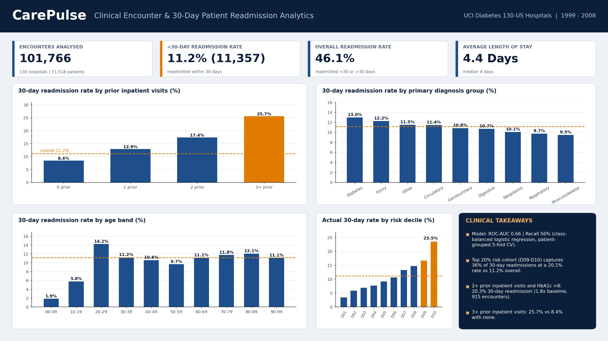

# CarePulse – Clinical Encounter & 30-Day Patient Readmission Analytics

## What this project is about
Hospitals try to avoid patients coming back within 30 days of discharge. I used the UCI *Diabetes 130-US Hospitals (1999–2008)* dataset to look at which patients readmit most often and to build a simple model that ranks patients by risk, so follow-up could be focused where it matters most.

## Data
- **101,766** inpatient encounters, 50 columns, from 130 US hospitals (101,766 rows loaded, 71,518 different patients).
- `readmitted` is `<30`, `>30` or `NO`. I treat `<30` as the 30-day readmission and `<30` or `>30` as "any" readmission.
- `weight` is 97% empty and `payer_code` / `medical_specialty` are 40–50% empty, so I left them out. HbA1c was only recorded for about 17% of encounters.
- Primary diagnosis (ICD-9 `diag_1`) is grouped into circulatory, respiratory, digestive, genitourinary, diabetes, injury, musculoskeletal, neoplasms and other.

## Main findings
| Metric | Result |
|---|---|
| Encounters | 101,766 |
| Readmitted within 30 days | 11,357 (11.16%) |
| Readmitted at any time | 46.09% |
| Average length of stay | 4.40 days (median 4) |
| 30-day rate with 0 / 3+ prior inpatient visits | 8.4% / 25.7% |
| 2+ prior inpatient visits and HbA1c >8 | 20.3% (1.8x the overall rate, 915 encounters) |
| Model ROC-AUC (patient-grouped cross-validation) | 0.66 |
| Model recall / precision at the 0.5 threshold | 56% / 18% |
| Top 20% risk cohort | 20.1% readmitted within 30 days, holds 36% of all 30-day readmissions |

Things I noticed along the way:
- Prior inpatient history is what drives risk. Everyone with 2+ prior inpatient visits has a 30-day rate of 21.4%, so adding "HbA1c >8" does not raise it further in this data.
- Among patients who had HbA1c measured, those with high values were not readmitted more often than those with normal values.
- Diabetes and injury are the primary-diagnosis groups with the highest 30-day rates; the differences between groups are small compared with the prior-visit effect.
- The model only separates risk moderately. It is a first-pass triage score, not something to base clinical decisions on.

## Model
Class-balanced logistic regression (`class_weight='balanced'`, `solver='lbfgs'`, `max_iter=200`, `random_state=42`) on utilisation counts, age, gender, race, admission category, diagnosis group, HbA1c status, discharge group, insulin and medication-change flags. The same patient appears in several encounters, so I used 5-fold cross-validation grouped by patient; every encounter's `predicted_risk_prob` comes from a model that never saw that patient. Deciles run from D01 (lowest risk) to D10 (highest).

## Files
| File | Description |
|---|---|
| `CarePulse_Readmission_Analytics.ipynb` | Full analysis: cleaning, labelling, exploration, model, SQL checks, exports |
| `CarePulse_Readmission_Analysis.sql` | MySQL schema for 3 tables plus queries using CTEs, `DENSE_RANK()`, `ROW_NUMBER()` and `AVG()/SUM() OVER` |
| `carepulse_powerbi_ready.csv` | Encounter-level data for Power BI with text labels for every dimension |
| `PowerBI_DAX_Measures.dax` | DAX measures for the dashboard |
| `dim_patients.csv`, `dim_admission_types.csv`, `fact_clinical_encounters.csv` | The three normalised tables |
| `carepulse_dashboard.png` | Static preview of the dashboard |

## How to run
1. Download the dataset zip from UCI and put it next to the notebook.
2. Run the notebook top to bottom (under a minute).
3. For MySQL: run the DDL at the top of the `.sql` file, then run the `to_sql` cell in the notebook or use `LOAD DATA LOCAL INFILE`. Change the password in the connection cell to your own.
4. For Power BI: import `carepulse_powerbi_ready.csv` as a table named `Encounters` and paste in the measures from the `.dax` file.

## Limitations
- Data is from 1999–2008 and only covers diabetic inpatients, so patterns may not match current practice.
- Readmissions are only seen if they happen in the same hospital network.
- `dim_patients` keeps the age band from each patient's first encounter, so age-band results in SQL differ slightly from the encounter-level age bands used in the notebook and Power BI file.
- `admission_source_category` in `dim_admission_types` is the most common source for each admission type, not a one-to-one mapping.
- The SQL queries were checked by running them on an in-memory SQLite copy of the tables; the MySQL load and connection cells need a local server and were not run in the saved notebook.
